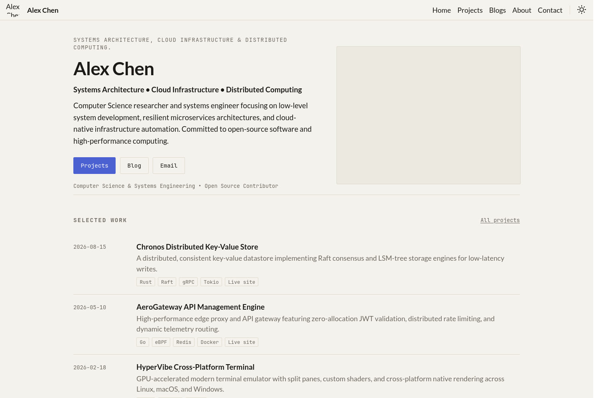

# pfp-template

[](https://gohugo.io/)
[](LICENSE)
[](https://themes.gohugo.io/t/pfp-template)

A portfolio and blog theme for Hugo, built for developers who want a personal
site with an interactive 3D hero, a data-driven project showcase, a technical
skills matrix, and a full blog — with **no Node.js or npm build step**.

Targets the Hugo **v0.156.0+** template system: `layouts/home.html`, a root
`baseof.html`, `_partials/`, `_shortcodes/`, and separate `taxonomy.html` /
`term.html` templates.

| | |
|---|---|
| **Live demo** | <https://shivjeet1.github.io/pfp-template/> |
| **Version** | 0.156.0 and later (extended) |
| **License** | [MIT](LICENSE) |



*The bundled example site is fan content set in the world of* The Eminence in
Shadow *by Daisuke Aizawa. Swap it for your own content.*

---

## Features

- **Interactive 3D WebGL hero** — drag to rotate, scroll to zoom. Fully
  procedural geometry and shaders, so there are no `.gltf` models or texture
  downloads. Adapts to your accent colour and the active light/dark theme.
- **Dark and light mode** — instant toggle, persisted in `localStorage`, with
  the saved theme applied before first paint so there is no flash of the wrong
  colours.
- **Data-driven project showcase** — rendered from `data/projects.yml` with
  date, summary, language chips, and an optional live-site link.
- **Skills matrix** — categorised cards rendered from `data/skills.yml`, with
  either a text glyph or a Feather icon per entry.
- **Blog** — reading time, table of contents with scrollspy, and tag/category
  taxonomies.
- **No build pipeline** — CSS and JS are bundled, minified, and fingerprinted
  by Hugo Pipes. Nothing to install beyond Hugo.
- **SEO and social cards** — OpenGraph, Twitter Card, and JSON-LD generated
  from your content.
- **Offline reading** — an optional service worker with a stale-while-revalidate
  cache for assets.
- **Accessibility and motion** — semantic markup, keyboard-navigable menu, and
  `prefers-reduced-motion` support throughout.

---

## Requirements

- **Hugo extended, v0.156.0 or later.** Check with `hugo version`.
- No Node.js, npm, or any other build tooling.

---

## Installation

### As a Hugo module (recommended)

```bash
hugo mod init github.com/you/your-site
```

Add the import to your `hugo.toml`:

```toml
theme = "pfp-template"

[module]
  [[module.imports]]
    path = "github.com/shivjeet1/pfp-template"
```

Then fetch it:

```bash
hugo mod get -u
```

### As a Git submodule

```bash
git submodule add https://github.com/shivjeet1/pfp-template.git themes/pfp-template
```

Then set the theme in `hugo.toml`:

```toml
theme = "pfp-template"
```

### Running the bundled example site

```bash
git clone https://github.com/shivjeet1/pfp-template.git
cd pfp-template/exampleSite
hugo server
```

Open <http://localhost:1313>.

> **Note**
> `exampleSite/hugo.toml` sets `themesDir = "../.."`, which resolves the theme
> relative to the repository root. That means the checkout directory has to be
> named `pfp-template`. If you renamed it, either rename it back or pass the
> path explicitly:
>
> ```bash
> hugo server --themesDir /path/to/your/renamed/directory
> ```

---

## Configuration

`exampleSite/hugo.toml` is the reference configuration. This is the same file
with the demo persona replaced by placeholder values:

```toml
baseURL = "https://example.com/"
title = "Your Name"
defaultContentLanguage = "en"
enableEmoji = true
enableRobotsTXT = true

theme = "pfp-template"

[params]
  # Shown in the header. Falls back to images/avatar-round-192.png and
  # images/avatar-180.png when omitted.
  avatarURL = "images/avatar.png"
  avatarAltText = "Your Name"
  favicon = "images/avatar-round-192.png"
  faviconLarge = "images/avatar-512.png"
  appleTouchIcon = "images/eminence.png"

  # Hero. heroScript is loaded on the home page only; the default is the
  # theme's own scene at /js/hero-scene.js.
  heroScript = "js/hero-scene.js"
  heroMeta = "A short line under the hero"

  # Buttons
  CtaProjectsText = "Projects"
  CtaBlogsText = "Blog"
  resumeURL = "/resume.pdf"
  ResumeText = "Resume (PDF)"

  # Home section headings
  ProjectsSectionTitle = "Selected Work"
  ProjectsSectionLinkText = "All projects"
  BlogsSectionTitle = "Writing"
  BlogsSectionLinkText = "All posts"
  AboutSectionTitle = "About"
  ContactSectionTitle = "Contact"

  showBackToTopButton = true

  # Extra stylesheets, resolved from your assets/css directory and minified.
  cssFiles = ["css/navbar.css", "css/skills.css"]

  accentColor = "#4B61D1"
  fontSize = "1.1rem"

  description = "One or two sentences describing what you do."
  author = "Your Name"
  metaKeywords = ["your keywords", "and a few more"]
  dateFormat = "January 2, 2006"
  footer = "All rights reserved."

  # Raw HTML injected into <head>, into the comment area below each post, and
  # before </body>. Rendered with safeHTML, so only put markup you trust here.
  # CustomHeadHTML = "<link rel='preconnect' href='https://fonts.example'>"
  # CustomCommentHTML = "<script defer src='https://comments.example/t.js'></script>"
  # CustomFooterHTML = "<script defer src='https://analytics.example/t.js'></script>"

  # Hide the theme credit in the footer
  DisableThemeCredit = false

  # Post listing options
  DisplayReadingTime = true
  TogglePreviousAndNextButtons = true

  # Tags that should not appear as meta on posts
  # [params.Hidden]
  #   Tags = ["Drafts"]
  #   TagsPostDate = []
  #   TagsPostDescription = []

# Social icons rendered in the header, hero, and footer.
# Recognised names: github, linkedin, twitter, gmail, rss
socialIcons = [
  {name = "github", url = "https://github.com/username"},
  {name = "linkedin", url = "https://linkedin.com/in/username"},
  {name = "twitter", url = "https://x.com/username"},
  {name = "gmail", url = "mailto:hello@example.com"},
  {name = "rss", url = "/blogs/index.xml"}
]

[menu]
  [[menu.main]]
    name = "Home"
    url = "/#home"
    weight = 1

  [[menu.main]]
    name = "Projects"
    url = "/#projects"
    weight = 2

  [[menu.main]]
    name = "Blogs"
    url = "/#blogs"
    weight = 3

  [[menu.main]]
    name = "About"
    url = "/#about"
    weight = 4

  [[menu.main]]
    name = "Contact"
    url = "/#contact"
    weight = 5

[markup]
  [markup.tableOfContents]
    startLevel = 1
    endLevel = 4
    ordered = false

[minify]
  minifyOutput = true
```

### Parameters

| Parameter | Type | Default | Purpose |
|---|---|---|---|
| `avatarURL` | string | — | Image in the header, and the OpenGraph fallback |
| `avatarAltText` | string | `avatar` | Alt text for the header image |
| `favicon` | path | `images/avatar-round-192.png` | Favicon, declared at `sizes="192x192"` |
| `faviconLarge` | path | `images/avatar-512.png` | Favicon, declared at `sizes="512x512"` |
| `appleTouchIcon` | path | `images/avatar-180.png` | iOS home-screen icon (`180x180`, kept square — iOS masks it) |
| `heroScript` | path | `/js/hero-scene.js` | Hero scene loaded on the home page |
| `heroMeta` | string | — | Small line beneath the hero buttons |
| `description` | string | — | Hero tagline and meta description fallback |
| `author` | string | — | Used in JSON-LD |
| `metaKeywords` | []string | — | Merged with each post's tags |
| `accentColor` | hex | `#4B61D1` | Accent colour, also feeds the hero scene |
| `fontSize` | CSS length | `1.1rem` | Root font size |
| `dateFormat` | Go layout | `January 2, 2006` | Post date format |
| `footer` | string | — | Footer text |
| `cssFiles` | []string | — | Extra stylesheets from `assets/css` |
| `showBackToTopButton` | bool | `false` | Floating back-to-top button |
| `resumeURL` | path | — | Adds a resume button when set |
| `DisplayReadingTime` | bool | `false` | Reading time on posts |
| `TogglePreviousAndNextButtons` | bool | `false` | Prev/next links on posts |
| `DisableThemeCredit` | bool | `false` | Removes the theme credit from the footer |
| `CustomHeadHTML` | HTML | — | Injected before `</head>` |
| `CustomCommentHTML` | HTML | — | Injected into `#comments` below each post |
| `CustomFooterHTML` | HTML | — | Injected before `</body>` |
| `Hidden.Tags` | []string | — | Tags excluded from post meta |
| `ProjectsSectionTitle` | string | `Selected Work` | Home section heading |
| `ProjectsSectionLinkText` | string | `All projects` | Link beside the heading |
| `BlogsSectionTitle` | string | `Writing` | Home section heading |
| `BlogsSectionLinkText` | string | `All posts` | Link beside the heading |
| `AboutSectionTitle` | string | `About` | Home section heading |
| `ContactSectionTitle` | string | `Contact` | Home section heading |
| `CtaProjectsText` | string | `Projects` | Hero button label |
| `CtaBlogsText` | string | `Blog` | Hero button label |
| `ResumeText` | string | `Resume (PDF)` | Hero button label |
| `socialIcons` | []table | — | Social links (see above) |

---

## Projects showcase

The home page renders the first four entries from `data/projects.yml`; the
`/projects/` page lists all of them.

```yaml
# data/projects.yml
- title: "Chronos"
  summary: "A distributed key-value store built on Raft."
  date: "2026-08-15"
  lang: "Rust, gRPC, Tokio"   # comma-separated; rendered as chips
  link: "https://github.com/example/chronos"
  live: "https://chronos.example.org"   # optional; renders a "Live site" chip
```

| Field | Required | Notes |
|---|---|---|
| `title` | yes | Project name |
| `summary` | yes | One line of description |
| `date` | no | Shown in the left column |
| `lang` | no | Comma-separated string, split into chips |
| `link` | no | Falls back to `#` |
| `live` | no | Adds a "Live site" chip |

---

## Skills matrix

Render the matrix anywhere in Markdown with the `skills` shortcode. It reads
`data/skills.yml`.

```yaml
# data/skills.yml
- category: "Shadow"
  items:
    - name: "Manipulation"
      glyph: "☾"     # any text glyph
    - name: "Spatial Gates"
      glyph: "⊞"
    - name: "Perception"
      icon: "eye"    # or a Feather icon name
```

```markdown

```

Each item takes either `glyph` (a text glyph, rendered as-is) or `icon` (a
[Feather](https://feathericons.com/) icon name). `glyph` takes precedence.

---

## Blog posts

```bash
hugo new blogs/my-first-post.md
```

```markdown
---
title: "Architecting High-Throughput Web Services"
date: 2026-03-24T10:00:00Z
draft: false
tags: ["Architecture", "Distributed Systems"]
categories: ["Engineering"]
description: "Meta description; also used for social cards."
summary: "Shown in blog listings."
weight: 10          # ordering within the section
type: post
image: "images/avatar.png"   # social card image
showTableOfContents: true     # renders the sidebar TOC
---

Your content goes here...
```

Supported front matter: `title`, `date`, `lastmod`, `draft`, `tags`,
`categories`, `description`, `summary`, `weight`, `type`, `slug`, `author`,
`image`, `showTableOfContents`, and `h1` for overriding the rendered heading.

Add a table of contents to any post with `showTableOfContents: true`. Depth is
controlled by the `[markup.tableOfContents]` settings in `hugo.toml`.

### Shortcodes

| Shortcode | Purpose |
|---|---|
| `` | Renders the skills matrix from `data/skills.yml` |
| `` | Renders a project row, used on the projects page |

`development` accepts `title`, `link`, `live`, `date`, `summary`, and `lang`:

```markdown

```

---

## The hero scene

The hero is rendered by a Three.js module loaded on the home page only. The
theme ships two scenes:

- `static/js/hero-scene.js` — the theme default, a kinetic orbital form.
- `exampleSite/static/js/umbra-gate.js` — the demo's iris-and-rim gate, set in
  `heroScript`.

Point `heroScript` at your own file to replace it:

```toml
[params]
  heroScript = "/js/my-scene.js"
```

Notes on the demo scene, which the default follows:

- Geometry is generated at runtime. No model files, no texture downloads.
- Drag rotates; the wheel zooms, but only while the pointer is over the canvas.
  Ctrl/Meta + wheel still zooms the page normally, so page scrolling is never
  hijacked. `+` and `-` work as a keyboard fallback.
- `prefers-reduced-motion: reduce` renders a single static frame.
- Below 900px wide, or with data saver on, the scene is skipped and the canvas
  is hidden.

To remove the hero entirely, comment out the `hero__canvas-wrap` block in
`layouts/home.html` and drop `heroScript`.

---

## Customisation

Site-level styles go in `assets/css/` and are registered through `cssFiles`:

```toml
[params]
  cssFiles = ["css/navbar.css", "css/skills.css"]
```

Each file is minified by Hugo Pipes at build time. Theme styles live in
`assets/css/main.css` (light) and `assets/css/dark.css` (dark); override them
with your own rules loaded after.

To change the palette globally, set `accentColor`. The hero scene reads the
same value, so it re-tints without any extra configuration.

---

## Offline support

`static/sw.js` registers a service worker that caches assets with a
stale-while-revalidate strategy. It stands down on `localhost` (so local
previews are not served stale) and when the connection reports data saver.

---

## Privacy

The theme sets no cookies and loads no third-party trackers. The only value
persisted is your light/dark preference, stored in `localStorage` on your own
device. `exampleSite/content/privacy.md` is a starting point for your own
policy page.

---

## Development

```bash
cd exampleSite
hugo server --buildDrafts --buildFuture
```

Layout reference:

```
layouts/
├── baseof.html          # document shell
├── home.html            # single-page home: hero, projects, blogs, about, contact
├── page.html            # standalone pages
├── single.html          # default single view
├── list.html            # section listings
├── taxonomy.html        # taxonomy term list
├── term.html            # a single taxonomy term
├── 404.html
├── alias.html
├── _partials/           # head, header, footer, toc, post, page, home-*
└── _shortcodes/         # skills, development
```

Assets:

```
assets/
├── css/                 # main, dark, navbar, skills, normalize
└── js/                  # main.js, feather-icons, svg-injector

static/
├── js/hero-scene.js     # default hero scene
├── sw.js                # offline service worker
└── images/              # avatar, favicon, apple touch icon
```

---

## Troubleshooting

**`hugo` reports the theme cannot be found (exampleSite).** The checkout
directory is not named `pfp-template`, so `themesDir = "../.."` does not
resolve. Rename it, or run `hugo server --themesDir /path/to/directory`.

**The hero canvas is blank.** The scene skips itself on viewports under 900px,
when data saver is on, when `prefers-reduced-motion` is set, and when WebGL is
unavailable. On desktop with WebGL enabled it should render; check the browser
console for errors.

**Styles I added in `assets/css` are not loading.** `cssFiles` resolves paths
relative to `assets/`, so the entry is `css/filename.css`, not
`filename.css`. A missing file is skipped silently.

**Avatar or favicon not showing.** Use relative paths for static assets in config
(e.g., `images/avatar.png`) rather than a leading slash (`/images/avatar.png`).
Leading slashes resolve to the domain root and 404 when the site is served from
a subpath (like GitHub Pages project sites). Hugo will join relative paths to
your `baseURL`.

---

## Submitting to the Hugo Themes Showcase

To be listed on [themes.gohugo.io](https://themes.gohugo.io/), open a pull
request against [gohugoio/hugoThemesSiteBuilder](https://github.com/gohugoio/hugoThemesSiteBuilder)
adding your theme to `themes.txt` in alphabetical order:

```
pfp-template=https://github.com/shivjeet1/pfp-template
```

---

## License

[MIT](LICENSE) © Shivam Lawale

The example site content is fan work set in the world of *The Eminence in
Shadow* by Daisuke Aizawa and is not covered by the theme license. Replace it
with your own content before publishing.
